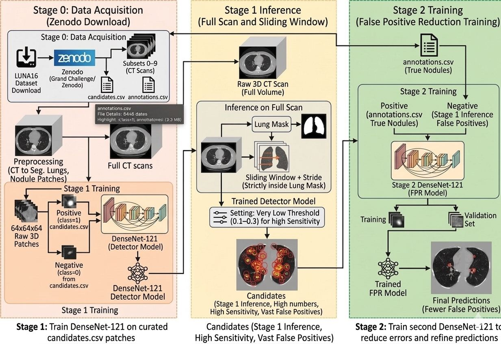

# LUNA16: Pulmonary Nodule Detection
### Two-stage deep learning pipeline: candidate detection + false-positive reduction



## Overview

A pipeline for automatic **pulmonary nodule detection in 3D chest CT** on the public **LUNA16** benchmark (888 scans from
LIDC-IDRI, radiologist-annotated nodules):

1. **Stage 1, candidate detector:** a 3D DenseNet-121 classifies 64x64x64 patches as nodule / non-nodule. A low threshold
   keeps sensitivity high, so it produces many candidates, most of them false positives.
2. **Stage 2, false-positive reduction (FPR):** a second 3D DenseNet-121 trained with hard negatives mined from Stage 1
   filters the candidates.

Full scan inference: resample to 1 mm -> lung segmentation -> sliding window (stride 16) -> Stage 1 (threshold 0.10) ->
3D non-maximum suppression (10 voxels) -> Stage 2 (threshold 0.30) -> final nodule locations.

## Results

Patch level (patient-level 80/20 split, so no patient appears in both train and validation):

| Model | ROC-AUC | Threshold | Sensitivity | Specificity |
|---|---|---|---|---|
| Stage 1 detector (6,056 patches) | 0.9735 | 0.15 | 94.8% | 84.6% |
| Stage 2 FPR model (1,713 patches) | 0.9796 | 0.30 | 96.8% | 74.5% |

Full pipeline on 50 scans of held-out subset 9 (90 ground-truth nodules):

| | Stage 1 | Stage 1 + Stage 2 |
|---|---|---|
| True positives | 88 | 81 |
| False negatives | 2 | 9 |
| Sensitivity | 97.8% | 90.0% |
| False positives per scan | 639.1 | **140.7** |

Stage 2 removes 78% of the Stage 1 false positives. Bringing the rate toward the 0.125 to 8 false positives per scan
used by the official LUNA16 FROC metric is the main goal of the next phase; the step-by-step plan is in
[docs/FALSE_POSITIVE_REDUCTION_PLAN.md](docs/FALSE_POSITIVE_REDUCTION_PLAN.md).

## What is used where

| Part | Used by the trained pipeline | Reference implementation in `src/` |
|---|---|---|
| Lung segmentation | pretrained U-Net R231 from the [`lungmask`](https://github.com/JoHof/lungmask) package | `src/lung_mask.py`: classical 7-step morphological pipeline (NumPy/SciPy only) |
| Classifier | `monai.networks.nets.DenseNet121(spatial_dims=3)`, 11,244,674 parameters | `src/densenet121.py`: DenseNet-121 from scratch, 2D or 3D, same parameter count as MONAI (tested) |

The two `src/` modules are tested stand-alone implementations (see `tests/`); the trained checkpoints and the reported
numbers come from the `lungmask` + MONAI versions used in `scripts/`.

## Repository structure

```
├── scripts/                              # the notebooks as plain Python scripts (cells marked with "# %%")
│   ├── 01_eda_and_visualization.py       # nodule sizes, class balance, HU histograms, slices
│   ├── 02_lung_mask_generation.py        # lung masks for the CT scans
│   ├── 03_densenet_architecture_check.py # layers, parameter count, feature-map shapes
│   ├── 04_stage1_candidate_detector.py   # patch extraction, training, evaluation
│   ├── 05_stage2_false_positive_reduction.py  # hard-negative mining, training, evaluation
│   └── 06_full_pipeline_test.py          # end-to-end test on subset 9
├── src/
│   ├── lung_mask.py                      # classical lung segmentation
│   └── densenet121.py                    # DenseNet-121 (2D / 3D)
├── docs/FALSE_POSITIVE_REDUCTION_PLAN.md # phased plan to reduce false positives per scan
├── tests/test_pipeline_components.py     # lung mask and DenseNet tests
├── img/pipeline.jpeg
├── DataSet_Model_notebooks_DriveLink.txt # data, checkpoints and original notebooks on Google Drive
└── requirements.txt
```

The scripts were written for Colab: set `LUNA16_DIR` to the folder holding `annotations.csv`, `candidates.csv`, the
subsets and the checkpoints (default `./LUNA16_Project`). A CUDA GPU is needed for training and full-scan inference.

## Method

**Data (LUNA16):** `annotations.csv` (ground-truth nodules with diameter), `candidates.csv` (candidate coordinates with
label), and 10 subsets of `.mhd/.raw` scans. Volumes are converted to Hounsfield units (window -1000 to 400 HU),
resampled and cut into 64x64x64 patches.

**Stage 1:** positives from the nodule candidates, negatives sampled at 10 per positive per patient; augmentation (flips,
rotations, intensity jitter); Adam, learning rate 1e-4 with plateau scheduling, 20 epochs, batch 16; decision threshold
0.15 on validation to favour recall.

**Stage 2:** positives from `annotations.csv`; negatives are Stage 1 false positives (hard-negative mining). A freshly
initialised DenseNet-121, early stopping on validation loss, threshold 0.30.

**Classical lung mask (`src/lung_mask.py`):** threshold air (HU < -400) -> 3D closing -> connected components -> remove
components touching the in-plane border (external air) -> keep the two largest -> fill holes per axial slice -> dilate by
2 voxels to keep subpleural nodules.

## Implementation notes

- **Two implementations, clearly separated:** the trained pipeline uses `lungmask` and MONAI's 3D DenseNet-121; `src/`
  holds tested stand-alone versions. `src/densenet121.py` supports 2D and 3D and has exactly the MONAI parameter count
  (11,244,674); the 7.98 M figure usually quoted is the 2D ImageNet model.
- **Lung mask:** the volume is edge-padded before closing so the scanner background stays attached to the border; only the
  in-plane edges count as "border", so lungs touching the first or last slice are kept; component handling is vectorised.
- **Configurable paths:** `LUNA16_DIR` points to the data and checkpoints; Colab-only calls are commented out.

## Next steps: reduce false positives (summary of the plan)

1. **Iterative hard-negative mining:** rerun Stage 1, collect new false positives, retrain Stage 2, repeat; stratify by
   structure (vessels, airways, lymph nodes, chest wall).
2. **Multi-scale patches** (for example 64 at 1 mm, 32 at 2 mm, 20 at 4 mm) fused before the classifier, since nodules range
   from 3 to 30 mm.
3. **Stronger augmentation:** elastic deformation, random affine, HU window jitter, noise.
4. **Ensembles** of 3-5 FPR models (different seeds or folds), averaging probabilities.
5. **Official FROC / CPM evaluation** at 0.125, 0.25, 0.5, 1, 2, 4, 8 false positives per scan on all 10 subsets
   (cross-validation), instead of one 50-scan subset.
6. **Post-processing:** 3D NMS radius from nodule size, minimum diameter of 3 mm, lung-boundary validation.

## Setup

```bash
pip install -r requirements.txt
python -m unittest discover -s tests -v      # lung mask and DenseNet tests (CPU, about 10 s)
```

## References

- Setio et al., "Validation, comparison, and combination of algorithms for automatic detection of pulmonary nodules in
  computed tomography images: the LUNA16 challenge", Medical Image Analysis, 2017.
- Huang et al., "Densely Connected Convolutional Networks", CVPR 2017.
- Hofmanninger et al., "Automatic lung segmentation in routine imaging is primarily a data diversity problem, not a methodology problem", 2020 (`lungmask`).
